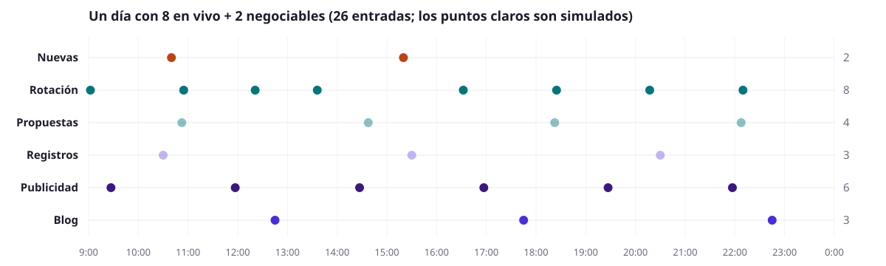

# VMC ahora: guía para llevarlo a producción

Para: Francis (implementación). Dueño del producto: Julio. Demo y reglas: Aaron. Última revisión: 26/10/2026.

## 1. Resumen en un minuto

VMC ahora es el feed de novedades del Index. Mientras la persona está en la página, van entrando entradas cortas, como posts: ofertas publicadas, ofertas que vuelven a mostrarse, avisos de propuestas, nuevos usuarios, publicidad de VMC y artículos del blog. No son notificaciones push ni ventanas emergentes.

Funciona así:

- Lo **real** (una oferta nueva, una propuesta o un registro) entra apenas pasa.
- Cuando no pasa nada real, entra **una entrada simulada cada 45 segundos** para que el feed no se vea muerto. Las simuladas salen de un plan del día que depende de cuántas ofertas hay publicadas.
- Cada hecho real **reemplaza** a uno simulado del mismo tipo. Si hay mucha actividad real, las simuladas desaparecen solas.

| Escritorio (columna derecha) | Móvil (debajo del banner) |
|---|---|
|  |  |

Lo que hay que hacer en producción es conectar los datos reales y llevar el reloj a la hora real. La parte visual ya está hecha en el lab y se copia de ahí. Ver la sección 3.

## 2. Cómo verlo

- **Deploy:** https://vmc-index-lab-orpin.vercel.app/qa/home-index-rebase
- **Local** (Node 24 y npm 11, desde la raíz del repo):

  ```
  npm ci
  npm run dev --workspace @vmc/index-lab -- --port 3001
  ```

  Luego abrir http://localhost:3001/qa/home-index-rebase.

- **Ver un día entero rápido:** en "Abrir controles" (abajo a la derecha):
  - poner **VMC ahora · velocidad** en ×10, para que entre una entrada cada 4,5 s;
  - en **VMC ahora · inventario**, elegir el escenario (0 ofertas, 10 en vivo, 8 + 2…).
- **Panel "VMC ahora · reloj":** muestra cuánto falta para la próxima simulada, el plan del día y el botón "Simular acción real".
- **Pausa:** con el puntero encima del feed, el reloj se detiene.

## 3. Alcance

**Le toca a producción:**

- Leer el inventario real: ofertas en vivo y negociables publicadas.
- Recibir los hechos reales: oferta nueva, propuesta enviada y usuario registrado.
- Armar el plan de simuladas del día con las fórmulas de la sección 6.
- Hacer correr el reloj a la hora real de Lima.
- Mostrar los contadores reales de cada oferta.

**No le toca a producción:**

- **Los controles de QA** (vista, diseño, tono, escenario, velocidad). Solo sirven para que Julio elija. En producción va lo que esté por defecto (sección 10).
- **El inventario de ejemplo** (`buildInventory`) y **los contadores inventados** (`entryViews`, `offerStats`). Son solo de la demo.
- **Las ideas de "Todavía no implementado"** (sección 9), salvo que Julio las apruebe.

## 4. Tipos de entrada

| `kind` | Autor | Texto | Origen | Captura |
|---|---|---|---|---|
| `nueva` / `nueva-subascars` | La empresa o SubasCars | "Publicó una nueva oferta en vivo: Toyota Yaris 2022. OFERTA 51015 · Lima · Base US$ 2,799" | **Real** |  |
| `rotacion` | Dueño de la oferta | "Disponible en vivo: Hyundai Tucson 2021…" o "Disponible para negociar: …" | **Real** (oferta que ya estaba publicada) |  |
| `propuesta` | VMC | "Se ha enviado una propuesta a la OFERTA 67942" | Simulada hoy, real después |  |
| `registro` | VMC | "Se registró un nuevo usuario en VMC" | Simulado hoy, real después |  |
| `ad-valoriza` | VMC | "Valoriza tu auto en VMC" + botón Valorizar | Publicidad fija |  |
| `ad-publica` | VMC | "Publica tu auto en VMC y recibe ofertas" + botón Publicar | Publicidad fija |  |
| `blog` | Blog VMC | Título del artículo + botón Leer | Artículo de VMC |  |

Acciones de cada entrada:

- **Ofertas:** me gusta, participantes (en vivo) o negociaciones (negociable), visitas y compartir.
- **Todo lo demás:** visitas y compartir.

El aviso de propuesta no tiene enlace. Dice que la propuesta **se envió**, no que se aceptó.

### Palabras

| Palabra | Qué significa |
|---|---|
| `V` | Ofertas **en vivo** publicadas ahora |
| `N` | Ofertas **negociables** publicadas ahora |
| `T` | `V + N`. Las propuestas no cuentan: con 8 en vivo, 2 negociables y 20 propuestas, `T` es 10 |
| Día | De 9:00 a 24:00, hora de Lima. Todo lo simulado se reparte en esas 15 horas |
| Rotación | Volver a mostrar una oferta ya publicada. Sale como "Disponible…", nunca como nueva |
| Simulada | Entrada que se inventa mientras no hay un hecho real de ese tipo (hoy: propuestas y registros) |
| Actividad (`A`) | Rotaciones + propuestas + registros + nuevas del día. Sirve para calcular cuánta publicidad sale |

## 5. Reglas

Estado de cada regla:

- **✅ Confirmada:** Julio la aprobó.
- **🟡 Propuesta:** ya funciona en la demo, pero falta el sí de Julio. Se implementa igual. Si Julio la cambia, solo cambia un número o una condición.

| # | Regla | Estado |
|---|---|---|
| R1 | Entra una entrada simulada cada **45 s** (`GAP_S`). Una real entra al momento y reinicia los 45 s | ✅ |
| R2 | Sin negociables (`N = 0`) no hay avisos de propuesta. Ese espacio pasa al blog: +2 artículos al día | ✅ |
| R3 | Con 6 ofertas o más, cada oferta rota **1 vez** al día | ✅ |
| R4 | Con 1 a 5 ofertas, cada oferta rota **3 veces** al día, con 5 h o más entre una vuelta y otra | 🟡 |
| R5 | Tope de propuestas simuladas al día: **5, 8 y 12** según `N` (sección 6) | 🟡 |
| R6 | Sin ofertas (`T = 0`) no se simula nada. El feed muestra solo publicidad y blog | 🟡 |
| R7 | Al abrir la página, la primera entrada es una publicidad. Sale como "Ahora" y no cuenta para los 45 s | 🟡 |
| R8 | Una oferta publicada hoy sale como nueva y **no rota** ese día | 🟡 |
| R9 | Los avisos de propuesta y de registro **no dicen quién fue** (privacidad) | 🟡 |
| R10 | La propuesta simulada lleva un código de oferta al azar que no choca con uno real, **no lleva foto** y no cambia ningún contador. La real lleva la foto de su oferta | 🟡 |
| R11 | Cada hecho real reemplaza a uno simulado del mismo tipo: `simuladas = máx(0, objetivo − reales)`. Los reales no tienen tope y nunca se ocultan | 🟡 |
| R12 | Nunca salen dos entradas de publicidad o blog seguidas si hay actividad en los 30 minutos siguientes | 🟡 |
| R13 | Las ofertas llevan siempre su foto y el blog su portada | 🟡 |
| R14 | Los contadores cuentan desde que la entrada sale en el feed. Una entrada de hace un minuto tiene pocas visitas | 🟡 |

### Ejemplos

**R1, una acción real reinicia el reloj**
- **Dado** que la última simulada salió a las 10:00:00,
- **cuando** llega una propuesta real a las 10:00:30,
- **entonces** la propuesta sale a las 10:00:30, la siguiente simulada no sale antes de las 10:01:15 y el plan del día tiene una propuesta simulada menos.

**R2, sin negociables**
- **Dado** 10 en vivo y 0 negociables,
- **entonces** en todo el día no sale ningún "Se ha enviado una propuesta" y salen 2 artículos de blog más.


**R6, sin ofertas**
- **Dado** 0 ofertas publicadas,
- **entonces** el feed muestra solo "Valoriza tu auto", "Publica tu auto" y artículos del blog. No sale ninguna rotación, propuesta ni registro.


**R8, oferta nueva**
- **Dado** que la OFERTA 51015 se publicó hoy a las 10:40,
- **entonces** sale "Publicó una nueva oferta…" y no vuelve a salir como "Disponible…" hasta mañana.

**R11, los reales reemplazan a los simulados**
- **Dado** que el plan del día tiene 4 propuestas simuladas,
- **cuando** a las 15:00 ya llegaron 3 propuestas reales,
- **entonces** queda 1 simulada para el resto del día. Si llega una cuarta real, ya no sale ninguna simulada. Si llegan 10 reales, salen las 10.

**R12, publicidad separada**
- **Dado** que en el plan quedan una publicidad a las 14:30 y un blog a las 14:31,
- **y** hay una rotación a las 14:50,
- **entonces** la rotación se adelanta entre las dos.

## 6. Fórmulas

Todas están en `feedPlan.ts`. La demo y los PDF salen de ese archivo, así que si cambia un número allí, cambian los tres.

### Rotaciones al día: `R(T)`

| `T` | Rotaciones al día | Cada oferta sale |
|---|---|---|
| 0 | 0 | — |
| 1 a 5 | `3 × T` (con 5 ofertas: 15, una por hora) | 3 veces, con 5 h o más entre vueltas |
| 6 a 30 | `T` | 1 vez |
| Más de 30 | 30 | 1 vez las 30 primeras; el resto no sale ese día (ver pregunta abierta P1) |

Las ofertas nuevas de hoy no rotan (R8), así que en el código queda:

`rotaciones = mín(R(T), vueltas × (T − nuevas))`

donde `vueltas` es 3 con `T` ≤ 5 y 1 desde 6.

Las ofertas se intercalan en vivo y negociables en proporción, para que no salgan cinco seguidas del mismo tipo.

### Avisos de propuesta simulados al día: `P(N)`

`P(N) = mín(2N, tope)`, es decir, nunca más de 2 al día por cada negociable.

| `N` | Tope |
|---|---|
| 0 | 0 |
| 1 a 4 | 5 |
| 5 a 11 | 8 (uno cada 2 h, más o menos) |
| 12 o más | 12 |

Con 1 negociable salen 2; con 2, salen 4; con 3 o 4, ya se llega al tope de 5. El tope es solo para las simuladas: las propuestas reales salen todas.

### El resto

| Entrada | Al día |
|---|---|
| Registros simulados `U(T)` | 0 si `T = 0`; si no, `mín(6, 1 + ⌊T / 4⌋)` |
| Ofertas nuevas | Las reales. La demo inventa 2 con `T` ≥ 6: una en vivo a media mañana y una negociable a media tarde |
| Publicidad + blog | `mín(15, máx(6, ⌈A / 2⌉))`. Un tercio es blog; el resto alterna las dos publicidades. +2 de blog si `N = 0` |

Cada tipo se reparte parejo entre las 9:00 y las 24:00: una rotación cada `900 / R` minutos, una propuesta cada `900 / P` minutos, y así con los demás.

### Ejemplo: 8 en vivo + 2 negociables

8 rotaciones, 4 propuestas, 3 registros, 2 nuevas, 6 publicidades y 3 artículos de blog: **26 entradas** en el día. Los puntos claros son simulados:



En `eleccion.pdf` está la misma cuenta para 13 escenarios, desde 0 + 0 hasta 40 + 20.

### Contadores

En producción se usan los contadores **reales** de la ficha de la oferta. Esta fórmula es solo para que la demo se vea creíble; sirve de referencia si se quieren contadores para publicidad y blog:

`visitas(t) = inicio + (tope − inicio) × (1 − e^(−t / τ))`

| Entrada | Visitas al salir | Tope | τ |
|---|---|---|---|
| Oferta nueva | 0 | 120 a 500 (muy buenas: 600 a 800) | 6 h |
| Oferta en rotación | 30 a 60 | igual | 6 h |
| Publicidad | 8 a 15 | 120 a 300 | 4 h |
| Blog | 5 a 12 | 80 a 200 | 5 h |
| Propuesta y registro | 0 | 40 a 200 | 3 h |

Cómo se muestran:

- **Me gusta y participantes:** del 4 % al 8 % de las visitas.
- **Negociaciones:** solo cuentan las propuestas reales.
- **Contador en 0:** se muestra solo el ícono. Excepciones: participantes en 0 dice "Sé el primero en participar"; negociaciones en 0 dice "Sin negociaciones aún".

## 7. Datos que necesita

### Inventario: ofertas publicadas ahora

| Campo | Para qué |
|---|---|
| `id` | "OFERTA 51015" y el enlace a la ficha |
| `mode` | `vivo` o `negociable`. Define `V`, `N`, el texto y el contador |
| `lot` | "Toyota Yaris 2022" |
| `city` | "Lima" |
| `price` | Base de la subasta. Si no hay precio, dice "Recibe propuestas" |
| `who` + logo | Autor de la entrada: la empresa o SubasCars |
| `imageSrc` | Foto principal (R13) |
| `publishedAt` | Decide si es nueva hoy (R8) |
| `closesAt` o estado | Una oferta cerrada deja de rotar |
| visitas, me gusta, participantes, negociaciones | Contadores reales de la ficha |

### Hechos reales: eventos

| Evento | Datos mínimos | Qué hace el feed |
|---|---|---|
| `offer.published` | La oferta completa | Entrada `nueva` al momento. Suma 1 a `T` |
| `offer.closed` | `id` | Deja de rotar. Resta 1 a `T` |
| `proposal.sent` | `offerId`, hora | Entrada `propuesta` con la foto de la oferta, **sin** el usuario. Descuenta una simulada |
| `user.registered` | Hora | Entrada `registro`, **sin** nombre. Descuenta una simulada |

### Dónde vive cada cosa (recomendación, no decisión)

- **Servidor:**
  - arma el plan del día con `planDay(V, N)`;
  - lleva cuántos reales hubo hoy por tipo;
  - reparte los eventos.
- **Cliente:**
  - muestra las últimas 8 entradas;
  - escucha eventos nuevos, por SSE, WebSocket o polling;
  - pinta la siguiente simulada cuando toca.
- **Por qué el plan va en el servidor:** así todos los visitantes ven el mismo feed a la misma hora.
- **Qué guardar:** solo los contadores del día; con eso se calcula `simuladas = máx(0, objetivo − reales)`.

### Casos borde

Las tres últimas filas son recomendación (no están en la demo, que repite el plan sin hora real); confirmarlas con Julio.

| Caso | Qué pasa |
|---|---|
| `T = 0` | Solo publicidad y blog (R6). Captura en la sección 5 |
| `N = 0` | Sin propuestas; +2 de blog (R2) |
| `T > 30` | Rotan 30. Cuáles: pregunta abierta P1 |
| Llega una propuesta a una oferta que ya cerró | Sale igual, con foto si la oferta todavía existe; sin foto si no (R10) |
| Muchos reales seguidos | Salen todos, uno por evento. No hay agrupación (ver sección 9, idea 3) |
| La persona abre la página a las 23:59 | Ve las últimas 8 del día. A las 24:00 empieza el plan del día siguiente |
| Antes de las 9:00 | No hay simuladas. Los reales sí entran |
| Cambia `T` durante el día | Se recalcula lo que queda del plan con el nuevo `T` |

## 8. Criterios de aceptación

Para dar por terminado el pase a producción:

- [ ] Con `T = 0` no sale ninguna rotación, propuesta ni registro en todo el día.
- [ ] Con `N = 0` no sale ningún aviso de propuesta.
- [ ] Una propuesta real aparece en el feed en segundos (meta sugerida: menos de 5 s), con la foto de su oferta y sin datos del usuario.
- [ ] Después de un real, la siguiente simulada no sale antes de 45 s.
- [ ] Con 3 propuestas reales en el día y un objetivo de 4, sale 1 simulada; con 4 o más reales, ninguna.
- [ ] Una oferta publicada hoy no aparece como "Disponible…" ese día.
- [ ] Una oferta cerrada no vuelve a rotar.
- [ ] La primera entrada al abrir la página es una publicidad.
- [ ] Nunca hay dos publicidades o blogs seguidos si hay actividad en los 30 minutos siguientes.
- [ ] Los contadores de las ofertas coinciden con los de su ficha.
- [ ] El conteo del día (rotaciones, propuestas, registros, publicidad) coincide con la tabla de `eleccion.pdf` para el mismo `V` y `N`.
- [ ] Se ve como la demo con los controles por defecto, en escritorio (1440) y en móvil (393).

## 9. Abierto

### Preguntas para Julio

| # | Pregunta | Propuesta actual |
|---|---|---|
| P1 | Con más de 30 ofertas, ¿cuáles 30 rotan? | Sin definir: la demo toma las 30 primeras. Opciones posibles: las que cierran antes, las de menos visitas, o ir turnando día a día |
| P2 | ¿Se aprueban los topes de propuestas 5, 8 y 12 (R5)? | Sí, como están |
| P3 | ¿Se aprueban las 3 vueltas con 1 a 5 ofertas (R4)? | Sí, con 5 h o más entre vueltas |
| P4 | Sin ofertas, ¿qué se muestra (R6)? | Solo publicidad y blog. Alternativas: ocultar VMC ahora o una entrada fija "Pronto nuevas ofertas" |
| P5 | ¿"En vivo" en la cabecera solo si `V > 0`? | Sí; si no, decir "Actividad de hoy" |
| P6 | ¿Qué palabras usa el contador? | La ficha dice "ofertas" y "propuestas"; VMC ahora dice "participantes" y "negociaciones". Elegir unas y usarlas en los dos lados |
| P7 | En móvil, ¿Opción A o B? | Se ven las dos con los botones Opción A / B del lab |

### Todavía no implementado (ideas)

1. **Alternar la primera publicidad en cada visita.** Hoy siempre sale la misma; la idea es alternar entre Valoriza y Publica.
2. **"En vivo" en la cabecera solo con ofertas en vivo.** Ver P5.
3. **Juntar reales seguidos.** Por ejemplo, "Se enviaron 3 propuestas a la OFERTA 67942" o "5 personas se registraron en la última hora".
4. **Mismas palabras en el contador.** Ver P6.

## 10. Diseño por defecto (lo que va a producción)

| Qué | Valor |
|---|---|
| Vista | Timeline en escritorio. En móvil hay dos versiones: Opción A (tarjeta con "Ver más") y Opción B (pestañas arriba, estilo X). Ver P7 |
| Publicidad | Tarjeta con la foto arriba y el botón de vidrio encima (`va-glass`, sin flecha) |
| Badge de publicidad | Sin badge |
| Visualizaciones | Ojo y número corto (1,2 mil); "1,234 visualizaciones" cuando solo hay visitas y compartir |
| Compartir | Flecha y caja |
| Insignias de tipo (EN VIVO, NEGOCIABLE…) | Apagadas |
| Texto destacado | En negrita y en negro (tipo, número de OFERTA, detalle) |
| Colores (tono oscuro) | En vivo `#C2410C`; negociable y propuestas `#00777A`; lo demás en morado (`#7B5CE6`, `#3B1782`, `#4A2CE0`) |
| Scroll | Gris claro |

Las fotos de la publicidad y del blog están en `apps/index-lab/public/banners/vmc`.

## 11. Mapa del código

| Archivo | Qué tiene |
|---|---|
| `apps/index-lab/app/qa/home-index-rebase/feedPlan.ts` | **Lo que se reutiliza.** Reglas y fórmulas, sin React: `counts`, `planDay`, `describe`, `rotationPerDay`, `proposalsPerDay`, `registrosPerDay`, `promoPerDay`, `mockupsLeft`, `checkPlan`, `COLORS`, `BLOG`. Solo de la demo: `buildInventory`, `entryViews`, `offerStats` |
| `apps/index-lab/app/qa/home-index-rebase/VmcAhora.tsx` | El feed: store con un solo reloj por página (`useSyncExternalStore`, tic de 500 ms, 8 entradas al abrir, pausa al pasar el puntero), las vistas y `simulateRealAction()`, que es lo que en producción hará un evento real |
| `apps/index-lab/app/qa/home-index-rebase/HomeIndexBlock.tsx` | Dónde va el feed en el Index y los controles de QA (`QA_CONTROLS`). Lo de QA no va a producción |
| `scripts/eleccion-pdf.mjs` → `eleccion.pdf` | Resumen en diapositivas: reglas, fórmulas, escenarios y lo que falta decidir |
| `scripts/escenarios-pdf.mjs` → `escenarios.pdf` | Versión larga, escenario por escenario |
| `scripts/vmc-ahora-docs.mjs` → `docs/vmc-ahora/` | Regenera las imágenes de esta guía, con el lab corriendo en `:3001` |

Para regenerar todo después de cambiar una fórmula:

```
node scripts/eleccion-pdf.mjs
node scripts/escenarios-pdf.mjs
node scripts/vmc-ahora-docs.mjs
```

Usan Edge por defecto. Con Chrome (Linux o macOS), anteponer `BROWSER_CHANNEL=chrome`.
